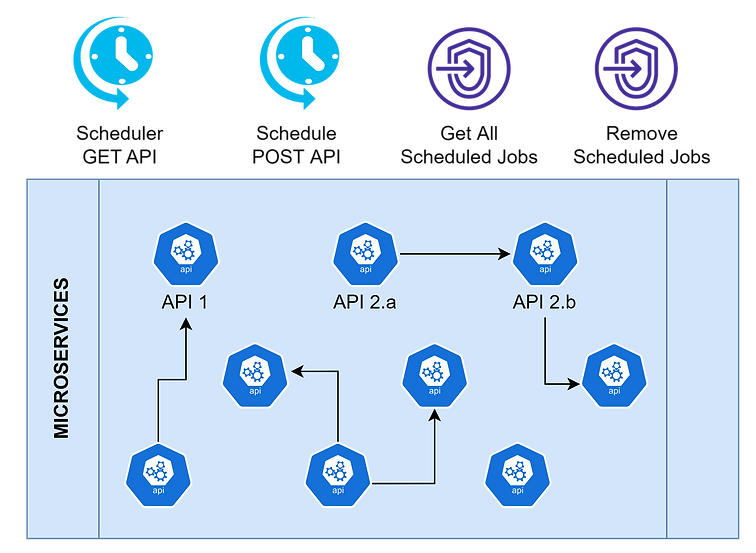

# spring-boot-scheduler

[](https://github.com/hendisantika/spring-boot-scheduler/actions/workflows/maven.yml)


[](.github/dependabot.yml)

Objective is to create a Spring Scheduler with dynamically scheduling jobs

It provides rest api's to schedule certain jobs/tasks using this Spring Scheduler, which will allow other projects
to use this service inside their microservices without any change/addition to the existing microservices. 



e.g. cron with every 10 seconds

```java

@Scheduled(cron = "0/10 * * * * *", zone = "Asia/Kolkata")
public void task() {
    System.out.println("Every 10 seconds");
}
```

e.g. fixed delay of 10 seconds

```java

@Scheduled(fixedDelay = 10000)
public void task() {
    System.out.println("Every 10 seconds");
}
```

e.g. fixed rate of 10 seconds

```java

@Scheduled(fixedRate = 10000)
public void task() {
    System.out.println("Every 10 seconds");
}
```

Or you can use the parameterized string, which will take value from *.properties or * yml file.

```java

@Scheduled(fixedDelayString = "${fixedDelay.in.millisec}")
public void task() {
    System.out.println("Every 10 seconds");
}
```

The project will have following REST endpoints:

```shell

Schedule GET API's:
Type: POST
endpoint: /scheduleIt
payload: Job
description: It will allow user to schedule the Rest API's of GET type.

Schedule POST API's:
Type: POST
endpoint: /schedulePost
payload: Job
description: It will allow user to schedule the Rest API's of POST type.

Get all scheduled Jobs:
Type: GET
endpoint: /scheduledJobs
description: It will allow user to see all the scheduled jobs in this application.

Delete any scheduled Jobs:
Type: DELETE
endpoint: /deleteJob/{jobId}
description: It will allow user to delete any scheduled job running in this application.
```

### Tech Stack

| Component         | Version / Notes                                   |
|-------------------|---------------------------------------------------|
| Java (JDK)        | **25** (Temurin recommended)                      |
| Spring Boot       | 4.1.2 (WebFlux, DevTools, Configuration Processor)|
| Build tool        | Maven 3.10.1 via Maven Wrapper (`./mvnw`)          |
| Lombok            | Managed by Spring Boot, wired as annotation processor |
| Testing           | Spring Boot Test, Reactor Test                    |

### Requirements

- JDK **25** installed and `JAVA_HOME` pointing to it (`java -version` should print `25`)
- No local Maven needed — use the bundled wrapper `./mvnw`

> **Note:** Since JDK 23, annotation processors are no longer discovered implicitly from the classpath.
> Lombok and `spring-boot-configuration-processor` are therefore registered explicitly through
> `annotationProcessorPaths` in the `maven-compiler-plugin` configuration of `pom.xml`.

### Build & Test

```shell
./mvnw clean verify          # compile, run tests & package
./mvnw spring-boot:run       # run the application on http://localhost:8080
```

### Things todo list

1. Clone this repository: `git clone https://github.com/hendisantika/spring-boot-scheduler.git`
2. Navigate to the folder: `cd spring-boot-scheduler`
3. Run the application: `./mvnw clean spring-boot:run` (requires JDK 25)
4. Open your Postman App
5. Import Postman Collection 

```shell
curl --location 'http://localhost:8080/scheduleIt' \
--header 'Content-Type: application/json' \
--data '{
    "jobName": "test-get3",
    "apiURL": "/hello",
    "baseURL": "http://localhost:8080",
    "cron": "10 * * * * *"
}'
```

```shell
curl --location 'http://localhost:8080/schedulePost' \
--header 'Content-Type: application/json' \
--data '{
    "jobName": "test-get",
    "apiURL": "/hello",
    "baseURL": "http://localhost:8080",
    "cron": "10 * * * * *"
}'
```

```shell
curl --location --request GET 'http://localhost:8080/scheduledJobs' \
--header 'Content-Type: application/json' \
--data '{
    "jobName": "test-get",
    "apiURL": "/hello",
    "baseURL": "http://localhost:8080",
    "cron": "10 * * * * *"
}'
```

```shell
curl --location --request DELETE 'http://localhost:8080/deleteJob/test-get3' \
--header 'Content-Type: application/json' \
--data '{
    "jobName": "test-get",
    "apiURL": "/hello",
    "baseURL": "http://localhost:8080",
    "cron": "10 * * * * *"
}'
```

```shell
curl --location 'http://localhost:8080/hello'
```

### CI/CD

GitHub Actions workflow [`.github/workflows/maven.yml`](.github/workflows/maven.yml):

- Triggers on push & pull request to `main`, plus manual `workflow_dispatch`
- Builds and tests with **JDK 25 (Temurin)** using `./mvnw -B -ntp clean verify` with Maven cache
- Cancels superseded runs on the same branch (`concurrency`) and uses least-privilege `permissions`
- Submits the Maven dependency graph (for better Dependabot alerts) **only on push to `main`**,
  because pull requests (including Dependabot PRs) don't get the `contents: write` permission it needs

### Dependabot

Configured in [`.github/dependabot.yml`](.github/dependabot.yml):

- **Maven** and **GitHub Actions** ecosystems, checked weekly (Monday 05:00 Asia/Jakarta)
- Minor/patch updates are **grouped** (Spring Boot, Maven plugins, others) to reduce PR noise;
  major updates come as individual PRs
- PRs are labeled (`dependencies`, `java` / `github-actions`), assigned, and use conventional
  commit prefixes (`deps`, `deps-dev`, `ci`)
